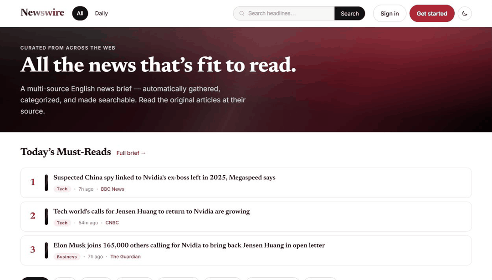
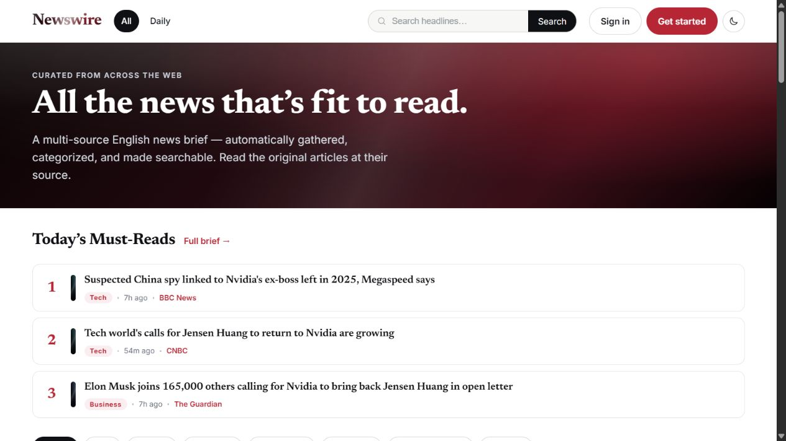
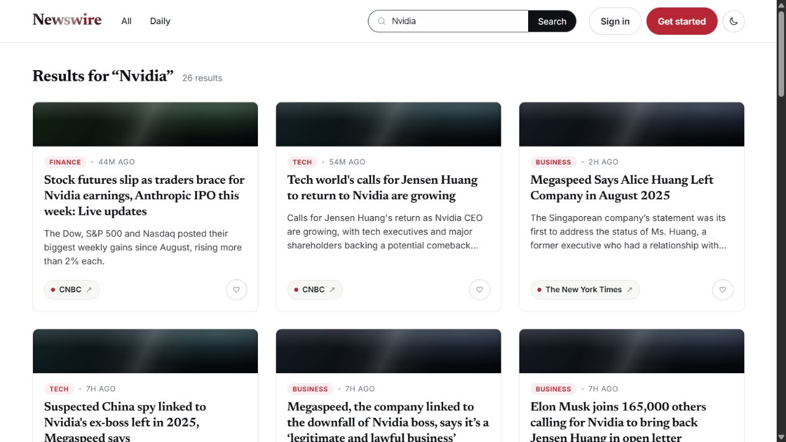
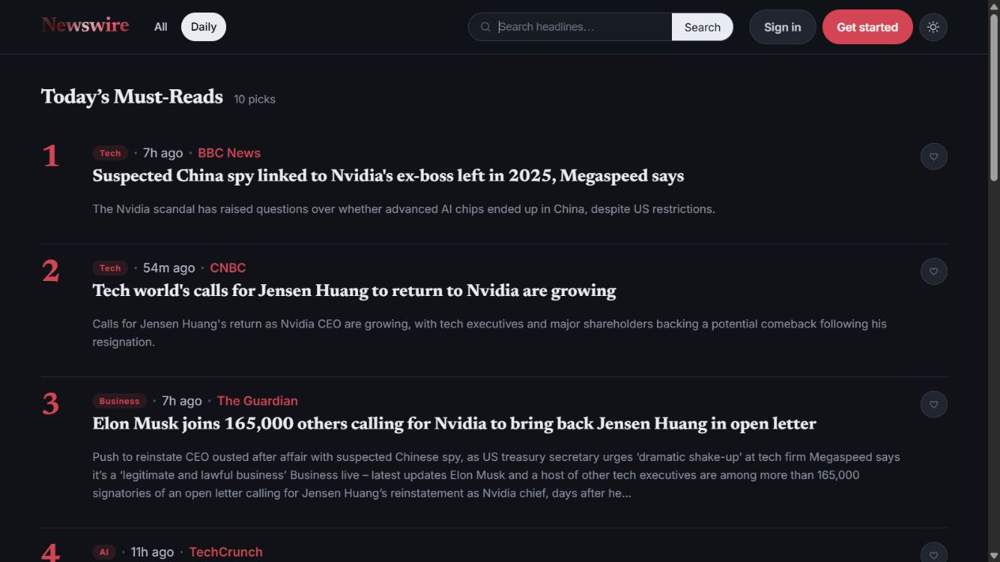
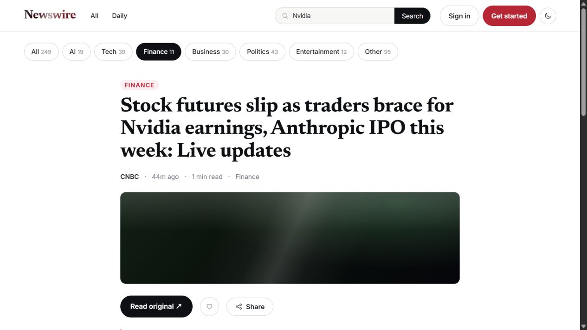

<p align="center"></p>
<h1 align="center">Newswire</h1>
<p align="center"><strong>A quick read across English news sources.</strong><br>Scan the headlines, find a story, and read it at the source.</p>
<p align="center">
  <a href="README.zh-CN.md">简体中文</a> ·
  <a href="https://newswire-2dq6.onrender.com/">Live demo</a> ·
  <a href="#run-it-locally">Run locally</a> ·
  <a href="DEPLOYMENT.md">Deploy</a>
</p>
<p align="center"></p>

Newswire brings 10 built-in RSS and Atom feeds into one browser view, including BBC News, CNBC, The Guardian, and TechCrunch. You can browse the public feed without an account. Stories show a short summary and a link to the publisher.

## What it does

### Browse by topic, source, or time

Start with **Latest** or switch to **Trending** to see the most viewed stories. Narrow the feed to a source, time range, or one of seven topics: AI, Tech, Finance, Business, Politics, Entertainment, and Other.

<p align="center"></p>

### Search across publishers

Type a name or a topic into the search bar. Full-text search looks through headlines and summaries, so a name mentioned only in a summary can still lead you to a story.

<p align="center"></p>

### Catch up with the daily brief

**Today’s Must-Reads** ranks up to 10 stories by freshness, source weight, and coverage across publishers. When recent stories are unavailable, the brief shows the latest available picks with a freshness notice. The site has light and dark themes.

<p align="center"></p>

### Read at the source

Open a story for its summary and related articles. **Read original** goes to the publisher. Sign in to bookmark stories and revisit or clear your browsing history.

<p align="center"></p>

## Run it locally

Requires **Node.js 24.x** and npm. These commands use SQLite and bundled sample stories so you can try the site without fetching live feeds.

```bash
git clone https://github.com/XinCiYR/Newswire.git
cd Newswire
npm run install:all
npm run migrate
npm --prefix server run seed -- --demo
npm run build:client
```

To keep the sample run offline, disable both background fetch paths before starting:

```bash
# macOS / Linux
ENABLE_IN_PROCESS_CRON=false SCRAPE_WATCHDOG=false npm start
```

```powershell
# Windows PowerShell
$env:ENABLE_IN_PROCESS_CRON = 'false'
$env:SCRAPE_WATCHDOG = 'false'
npm start
```

Open [localhost:4000](http://localhost:4000). To fetch live headlines on demand, run `npm run fetch` in a separate terminal. See the [deployment guide](DEPLOYMENT.md) for production secrets, PostgreSQL, Docker, and scheduled fetching.

## Under the hood

```text
RSS / Atom → normalize → categorize → deduplicate → SQLite / PostgreSQL
                                                          ↓
React ← Express API ← articles, search, daily brief, bookmarks and history
```

- [`client/`](client/) — React, React Router, esbuild, and plain CSS.
- [`server/`](server/) — Express, feed ingestion, authentication, search, and scheduled jobs.
- [`docs/`](docs/) — developer reference and demo media.

Feed fetching limits parallel requests and response size. A feed can return HTTP 304 to skip downloading unchanged content. SQLite uses FTS5; PostgreSQL uses an indexed full-text search vector.

## Development and data

Run `npm test` for regression tests or `npm --prefix client run smoke:test` for a frontend build and smoke check. The [CI workflow](.github/workflows/verify.yml) also covers PostgreSQL and Docker. See the [developer reference](docs/development.md) for API routes and configuration.

The server stores account details, bookmarks, and browsing history for signed-in users. Headlines and summaries are attributed to their original publishers; full articles are read on the publisher’s site. The screenshots and walkthrough show the live site on November 16, 2026; headlines change as feeds refresh.

Found an issue? [Open a GitHub issue](https://github.com/XinCiYR/Newswire/issues).
