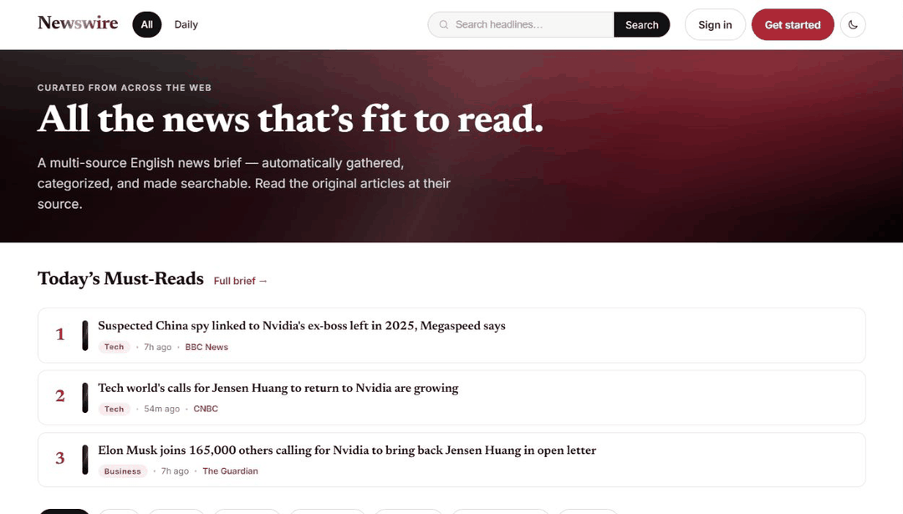
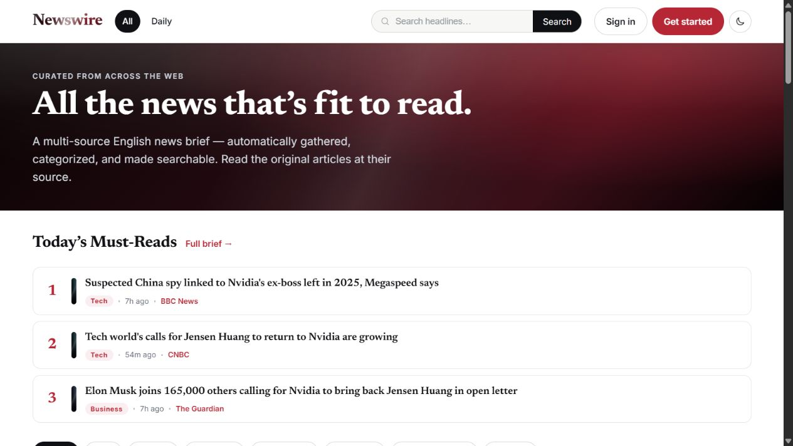
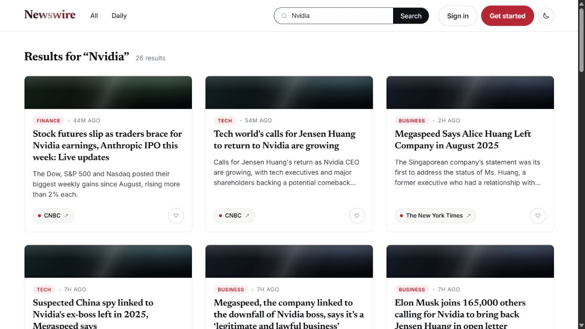
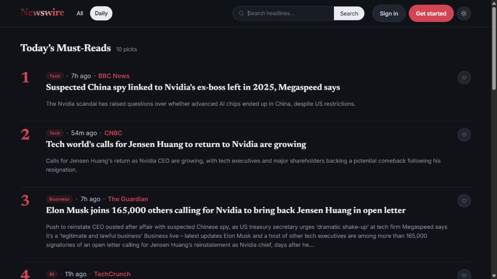

<p align="center"></p>
<h1 align="center">Newswire</h1>
<p align="center"><strong>在一个页面读多个英文新闻源。</strong><br>浏览头条、搜索感兴趣的故事，再到媒体网站读原文。</p>
<p align="center">
  <a href="README.md">English</a> ·
  <a href="https://newswire-2dq6.onrender.com/">在线演示</a> ·
  <a href="#本地运行">本地运行</a> ·
  <a href="DEPLOYMENT.md">部署说明</a>
</p>
<p align="center"></p>

Newswire 将 BBC News、CNBC、The Guardian、TechCrunch 等 10 个内置 RSS / Atom 新闻源汇总到一起。无需登录就能浏览公开内容，每篇新闻提供简短摘要和媒体原文链接。

## 可以做什么

### 按主题、来源或时间浏览

首页可在 **Latest（最新）** 和 **Trending（热门）** 之间切换。也可以按来源或时间范围缩小列表，或浏览 AI、科技、金融、商业、政治、娱乐和其他七个分类。

<p align="center"></p>

### 跨媒体搜索

在顶部搜索栏输入人名、公司或主题。全文搜索同时查找标题与摘要，即使关键词只出现在摘要中，也能找到相关报道。

<p align="center"></p>

### 用每日精选快速补读

**Today’s Must-Reads（每日精选）** 根据发布时间、来源权重和跨媒体报道情况选出最多 10 篇新闻。近期没有新报道时，页面会提示内容时效并显示最近可用的精选。网站支持浅色和深色模式。

<p align="center"></p>

### 到媒体网站读原文

打开新闻可查看摘要与相关报道，点击 **Read original** 前往媒体网站。登录后可收藏文章，并查看或清空浏览历史。

<p align="center"></p>

## 本地运行

需要 **Node.js 24.x** 和 npm。以下命令使用 SQLite 和内置示例新闻，无需拉取在线新闻就能体验网站。

```bash
git clone https://github.com/XinCiYR/Newswire.git
cd Newswire
npm run install:all
npm run migrate
npm --prefix server run seed -- --demo
npm run build:client
```

如果只想体验示例数据，启动前关闭两种后台采集方式：

```bash
# macOS / Linux
ENABLE_IN_PROCESS_CRON=false SCRAPE_WATCHDOG=false npm start
```

```powershell
# Windows PowerShell
$env:ENABLE_IN_PROCESS_CRON = 'false'
$env:SCRAPE_WATCHDOG = 'false'
npm start
```

打开 [localhost:4000](http://localhost:4000)。要主动采集一次在线新闻，可另开终端执行 `npm run fetch`。生产密钥、PostgreSQL、Docker 和定时采集的配置见[部署说明](DEPLOYMENT.md)。

## 项目结构

```text
RSS / Atom → 清洗 → 分类 → 去重 → SQLite / PostgreSQL
                                           ↓
React ← Express API ← 新闻、搜索、精选、收藏与历史
```

- [`client/`](client/)：React、React Router、esbuild 和原生 CSS。
- [`server/`](server/)：Express、新闻采集、账号、搜索与调度。
- [`docs/`](docs/)：开发参考与演示素材。

采集器限制请求并发和响应大小，新闻源返回 HTTP 304 时跳过重复下载。SQLite 使用 FTS5，PostgreSQL 使用带索引的全文搜索。

## 开发与数据说明

运行 `npm test` 执行回归测试，或用 `npm --prefix client run smoke:test` 验证前端构建和渲染。[CI 工作流](.github/workflows/verify.yml) 也覆盖 PostgreSQL 和 Docker。配置与 API 路由见[开发参考](docs/development.md)。

服务端保存登录用户的账号信息、收藏和浏览历史；标题及摘要注明媒体来源，全文在原媒体网站阅读。截图和动图来自 2026 年 11 月 16 日的线上站点，头条会随采集更新。

遇到问题可以[提交 GitHub Issue](https://github.com/XinCiYR/Newswire/issues)。
